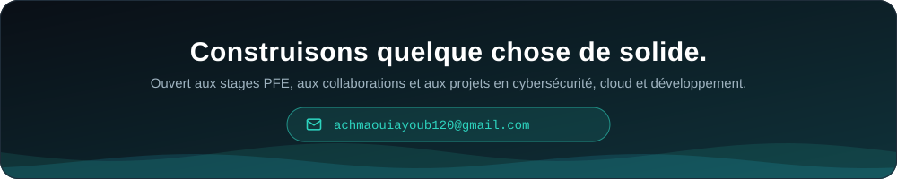

<div align="center">


<a href="https://www.linkedin.com/in/ayoub-achmaoui-47421133b"></a>
<a href="mailto:achmaouiayoub120@gmail.com"></a>
<a href="https://github.com/achmaouiayoub120-beep"></a>
</div>

<br/>


```bash
ayoub@el-jadida:~$ whoami
Ayoub Achmaoui

ayoub@el-jadida:~$ cat profile.txt
role        : Étudiant Bachelor Cybersécurité & Technologies Cloud (CSTC)
université  : Université Chouaïb Doukkali, El Jadida
formation   : DUT Génie Informatique (EST Sidi Bennour, 2024-2026)
focus       : cybersécurité · cloud · DevSecOps · développement web & mobile
certifié    : Cisco · IBM · SAP
recherche   : stage de fin d'études (PFE)

ayoub@el-jadida:~$ echo $MOTTO
"Construire des systèmes qui marchent, puis les sécuriser."
```

<br/>


<table>
<tr>
<td width="200" align="center" valign="middle"></td>
<td valign="middle"><b>Stagiaire</b> · HYDRAUMAC<br/><sub>Juin – Juillet 2026</sub></td>
</tr>
<tr>
<td width="200" align="center" valign="middle"></td>
<td valign="middle"><b>Stagiaire</b> · Ziryab Tec Académie<br/><sub>Mai – Juin 2026</sub></td>
</tr>
<tr>
<td width="200" align="center" valign="middle"></td>
<td valign="middle"><b>Stagiaire IT</b> · Groupe COSUMAR, usine d'El Jadida<br/><sub>Août 2025</sub>
<ul>
<li>Application mobile de présence par QR Code (<i>QR Code Présence</i>)</li>
<li>Découverte de l'ERP SAP : modules MM, PP, PM, SGRH</li>
<li>Digitalisation du suivi des présences</li>
</ul></td>
</tr>
</table>

<br/>



<table>
<tr>
<td width="33%" valign="top">
<b>Cybersécurité &amp; Systèmes</b><br/><br/>
<br/>
<sub>Sécurité des réseaux · Administration Linux et Windows · Virtualisation</sub>
</td>
<td width="33%" valign="top">
<b>Cloud &amp; DevOps</b><br/><br/>
<br/>
<sub>Cloud Computing · DevOps · DevSecOps</sub>
</td>
<td width="33%" valign="top">
<b>Langages</b><br/><br/>
<br/>
<sub>Web · Mobile · APIs REST</sub>
</td>
</tr>
<tr>
<td colspan="2" valign="top">
<b>Frameworks &amp; Données</b><br/><br/>

</td>
<td valign="top">
<b>ERP</b><br/><br/>

</td>
</tr>
</table>

<br/>


<table>
<tr>
<td width="50%"></td>
<td width="50%"><a href="https://github.com/achmaouiayoub120-beep/cosumar-smart-presence"></a></td>
</tr>
<tr>
<td width="50%"></td>
<td width="50%"></td>
</tr>
</table>

<br/>


<p align="center">


</p>

<br/>


<div align="center">


<br/><br/>
<picture>
<source media="(prefers-color-scheme: dark)" srcset="https://raw.githubusercontent.com/achmaouiayoub120-beep/achmaouiayoub120-beep/output/github-snake-dark.svg"/>
<source media="(prefers-color-scheme: light)" srcset="https://raw.githubusercontent.com/achmaouiayoub120-beep/achmaouiayoub120-beep/output/github-snake.svg"/>

</picture>
</div>

<br/>


<a href="mailto:achmaouiayoub120@gmail.com"></a>
